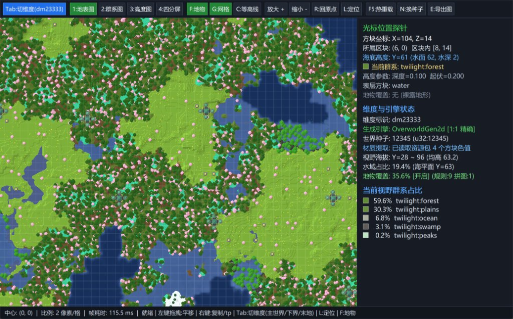

# mc_dim_render

[](../../releases)
[](../../releases)
[](skill/mc-dim-render/SKILL.md)

**专为 AI Agent 制作与调试网易《我的世界》自定义维度而设计的离线工具。** 无需启动游戏，AI Agent 即可通过无头 CLI（纯 JSON 输出 + 俯视 PNG 渲染）与配套 Skill，在修改维度、群系、**地物（`features`/`feature_rules`）、`.mcstructure` 模板及大型拼图结构（`netease_large_feature`）**配置的几秒内获得即时的离线数据与视觉反馈，完成开发—验证闭环。

同时，工具也内置了**给人看的原生中文 Win32 实时交互预览窗口（GUI）**，方便开发者直观巡检地形、群系过渡、地物分布与大型拼图结构，并支持右键复制 `/tp` 传送指令。



## 功能概览

- **全维度类型支持**：离线生成并渲染网易自定义维度（主世界 `overworld`、下界 `nether`、末地 `the_end`、超平坦 `generator_flat`），高度与水陆分布精确对齐 `3.10`（`1.21.130`）客户端。
- **完整群系与地表系统**：支持 `netease:biome_source` 群系节点管线、`minecraft:overworld_height` 高度预设、恶地 64 层陶瓦色带及 `surface_material_adjustments`。
- **支持地物与拼图结构**：离线解析并装饰行为包 `features` / `feature_rules`、`.mcstructure` 三维旋转投影、**网易大型拼图结构（`netease_large_feature_rules` / `netease_large_feature_pools`）** 以及原版地表结构网格。
- **资源包贴图自动取色**：自动发现同级资源包（`blocks.json`、`terrain_texture.json`、`.png`/`.tga`），提取自定义方块顶面真实颜色。
- **面向 AI Agent 的无头 CLI**：全部子命令支持静默输出纯 JSON，可直接接入 AI Skill 完成“修改 → 校验 → 定位 → 渲染看图 → 修正”自动化闭环。
- **原生中文 GUI 调试器**：支持鼠标拖拽 / `WASD` 平移、滚轮缩放、四分屏对比、等高线/区块网格、地物显隐、`F5` 热重载以及右键一键复制 `/tp @s X Y Z`。

## 提供的工具

| 工具 / 子命令 | 用途 | 适用场景 |
| :--- | :--- | :--- |
| **`validate`** | 离线配置校验与 1024×1024 采样 | 修改 JSON 后第一时间检查语法、群系管线、拼图配置告警与高度统计 |
| **`locate-biome`** | 群系高速定位 | 查找指定群系（或 tag）的最近世界坐标并生成 `/tp` 指令 |
| **`locate-structure`** | 结构与拼图定位 | 查找 `.mcstructure`、网易大型拼图结构（`netease_large_feature`）或原版地表结构坐标 |
| **`probe`** | 单点 / 多点精确探针 | 查询指定 `(x, z)` 的固体高度、水面、群系、顶层方块及地物/结构落位 |
| **`render`** | 无头多图层 PNG 与报告导出 | 导出地表图、群系图、高度图、四分屏合成图（PNG）及覆写覆盖率报告（JSON） |
| **`gui`** | 原生中文交互式预览窗口 | 人工拖拽浏览全局地图、微距检查建筑落位、热重载与右键复制传送坐标 |

## 安装与配置

### 1. 下载程序
前往本仓库右侧 **[Releases](../../releases)** 下载最新压缩包（如 `mc_dim_render-v3.0.0-win64.zip`），解压到本地任意目录（例如 `D:\tools\mc_dim_render`）。压缩包内包含：
- `mc_dim_render.exe`：主程序（零外部运行库依赖，开箱即用）
- `run_gui.bat`：一键启动示例包 GUI 预览
- `skill/mc-dim-render/`：配套 AI Agent Skill
- `examples/sample_pack/`：完整示例行为包与资源包（含自定义群系、地物、`.mcstructure` 与大型拼图）

### 2. 配置环境变量
将解压目录添加到系统环境变量 `PATH`（或设置环境变量 `MC_DIM_RENDER_EXE` 指向 `mc_dim_render.exe`），以便在任意模组工程目录下直接调用 `mc_dim_render`。

### 3. 安装配套 AI Skill（可选）
将 `skill/mc-dim-render` 目录复制到你使用的 AI 编程助手的技能目录中：
- **全局生效**：`~/.gemini/antigravity/skills/mc-dim-render/`（或对应工具的全局 skills 目录）
- **单项目生效**：模组工程根目录下的 `.agents/skills/mc-dim-render/`

## 使用方式

### 面向 AI Agent（CLI 闭环）

**先运行 `help`，不要凭记忆拼参数。** 完整子命令、参数选项、退出码与 JSON 返回格式以当前版本 `help` 输出为准：

```powershell
mc_dim_render help
```

典型 AI 验证流程：

```powershell
# 1. 校验行为包与配套资源包（退出码恒为 0，以返回 JSON 的 .valid 为准）
mc_dim_render validate --pack examples/sample_pack --dimension dm23333 --seed 2026

# 2. 定位自定义群系或大型拼图结构
mc_dim_render locate-biome twilight:oasis --pack examples/sample_pack --dimension dm23333 --seed 2026
mc_dim_render locate-structure twilight:citadel --pack examples/sample_pack --dimension dm23333 --seed 2026

# 3. 多点精确探针采样
mc_dim_render probe "0,0;-184,56;776,-508" --pack examples/sample_pack --dimension dm23333 --seed 2026

# 4. 导出四分屏合成图与诊断报告供 AI 视觉检查
mc_dim_render render --pack examples/sample_pack --dimension dm23333 --seed 2026 --mode composite --size 512 --scale 4 --out preview.png --report report.json
```

### 面向开发者（GUI 预览）

双击压缩包中的 `run_gui.bat` 即可直接预览示例维度，或在命令行指定自己的模组目录：

```powershell
mc_dim_render gui --pack <你的模组或行为包目录> --dimension <维度ID> --seed 2026
```

- **左键拖拽 / `WASD`**：平移视野；**滚轮 / `+` / `-`**：缩放地图（`64 格/像素` ~ `8 像素/格`）
- **右键单击地图**：自动复制该坐标的 `/tp @s X Y Z` 传送指令到剪贴板
- **`L`（定位）**：循环定位并跳转至最近的自定义拼图结构 / `.mcstructure` / 自定义群系
- **`F`（地物）**：切换地物与结构显隐；**`G`**：网格；**`C`**：等高线；**`1-4`**：切换视图；**`F5`**：热重载行为包与资源包

## 问题反馈

如在使用过程中遇到维度渲染异常、报错或新版本兼容问题，欢迎在 **[Issues](../../issues)** 中提交反馈。
