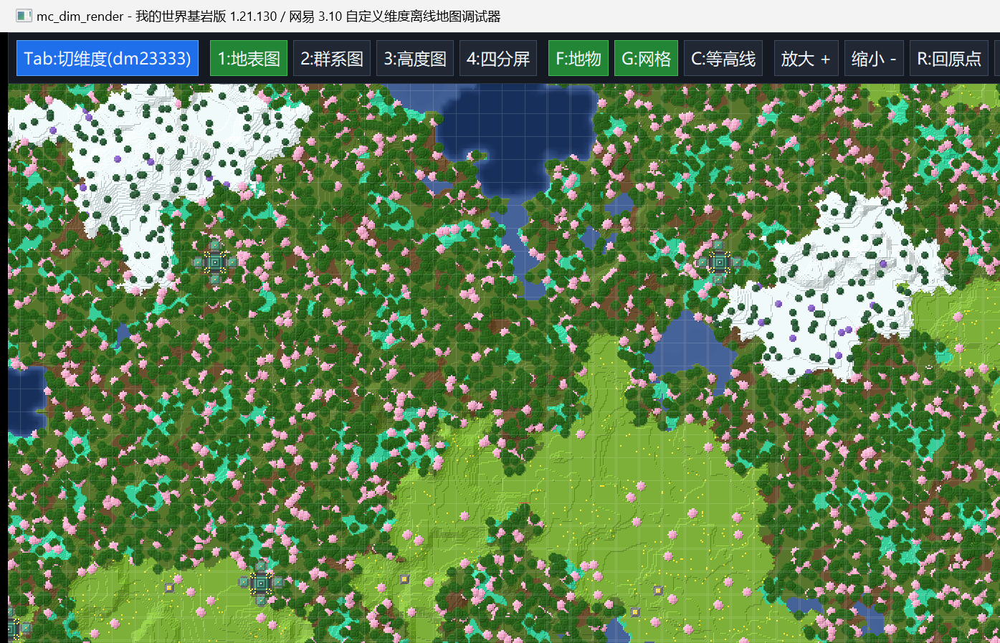

# mc_dim_render

**专为 AI Agent 制作与调试网易《我的世界》自定义维度而设计**——无需启动游戏，AI Agent 即可通过无头 CLI（纯 JSON 输出 + 俯视 PNG 渲染）与配套 Skill，在修改维度、群系、地物或结构配置的几秒内获得**即时的离线视觉与数据反馈**，完成闭环迭代。

同时，工具也内置了**给人看的原生中文实时交互预览窗口（GUI）**，方便开发者直观巡检地形、群系过渡、大型拼图结构并右键复制 `/tp` 传送指令。



适用游戏版本：**网易《我的世界》PC 基岩版 `3.10`（Bedrock `1.21.130`）**。

---

## 安装指南

### 1. 下载与解压

1. 前往本仓库右侧的 **[Releases](../../releases)** 页面，下载最新版本的压缩包（例如 `mc_dim_render-v3.0.0-win64.zip`）。
2. 解压到本地任意目录（例如 `D:\tools\mc_dim_render`），目录内包含：
   - `mc_dim_render.exe`：主程序（无外部运行库依赖，开箱即用）
   - `run_gui.bat`：一键启动示例包预览窗口
   - `skill/mc-dim-render/`：配套 AI Agent Skill
   - `examples/sample_pack/`：完整示例行为包与资源包

### 2. 配置环境变量（推荐）

为了在任意模组工程目录下都能直接运行 `mc_dim_render` 命令，建议完成以下任一配置：
- **方式 A**：将解压目录（例如 `D:\tools\mc_dim_render`）添加到系统环境变量 `PATH` 中；
- **方式 B**：新增系统/用户环境变量 `MC_DIM_RENDER_EXE`，值设为 `mc_dim_render.exe` 的完整路径。

配置完成后，新开终端输入以下命令验证是否生效：

```powershell
mc_dim_render help
```

### 3. 安装配套 AI Skill（可选）

如果你使用 AI 编程助手（如 Antigravity / Claude Code / Cursor 等）辅助制作自定义维度，可将解压目录或本仓库中的 `skill/mc-dim-render` 文件夹复制到对应技能目录：
- **全局生效**：复制到用户全局 Skill 目录（例如 `~/.gemini/antigravity/skills/mc-dim-render/`）
- **单项目生效**：复制到你的模组工程根目录 `.agents/skills/mc-dim-render/`

---

## 快速使用

### 1. 交互式预览窗口（GUI）

解压后可直接双击 `run_gui.bat` 体验示例维度，或在命令行指定自己的模组包：

```powershell
mc_dim_render gui --pack <你的模组或行为包目录> --dimension <维度ID> --seed 2026
```

常用快捷键：
- **左键拖拽 / `WASD`**：平移视野；**滚轮 / `+` / `-`**：缩放地图
- **右键单击地图**：自动复制该坐标的 `/tp @s X Y Z` 传送指令到剪贴板
- **`L`（定位）**：循环定位并跳转至最近的自定义拼图结构 / `.mcstructure` / 自定义群系
- **`F`（地物）**：一键切换树木/建筑地物层显隐；**`1-4`**：切换视图；**`F5`**：热重载行为包与资源包

### 2. 无头 CLI 查询（纯 JSON 输出）

```powershell
# 查看全部子命令、参数选项与 JSON 返回格式
mc_dim_render help

# 校验行为包与配套资源包配置
mc_dim_render validate --pack examples/sample_pack --dimension dm23333 --seed 2026

# 定位群系或结构（返回坐标、所属群系与 /tp @s X Y Z 指令）
mc_dim_render locate-biome twilight:oasis --pack examples/sample_pack --dimension dm23333 --seed 2026
mc_dim_render locate-structure twilight:citadel --pack examples/sample_pack --dimension dm23333 --seed 2026

# 单点/多点精确探针采样
mc_dim_render probe "0,0;-184,56;776,-508" --pack examples/sample_pack --dimension dm23333 --seed 2026

# 导出合成预览图与诊断报告
mc_dim_render render --pack examples/sample_pack --dimension dm23333 --seed 2026 --mode composite --size 512 --scale 4 --out preview.png --report report.json
```

---

## 问题反馈

如在使用过程中遇到维度渲染异常、报错或新版本兼容问题，欢迎在 **[Issues](../../issues)** 中提交反馈（请附上报错输出或相关维度配置片段）。
